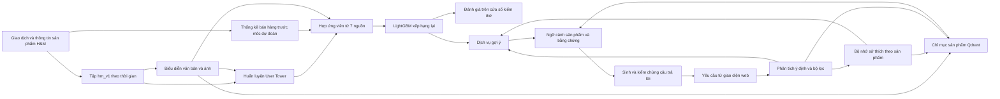

# CHƯƠNG 2: QUY TRÌNH XÂY DỰNG HỆ THỐNG GỢI Ý SẢN PHẨM ĐA PHƯƠNG THỨC VÀ CHATBOT RAG

> **Phạm vi bộ dữ liệu (cập nhật 05/10/2026):** bộ khung luận văn này viết theo bộ **Amazon**. Bộ dữ liệu chính mới là **H&M**; luận điểm được phép khẳng định, thực nghiệm còn thiếu và ánh xạ sửa từng chương nằm ở [`../hm/05_thesis_plan.md`](../../hm/docs/05_thesis_plan.md). Các số liệu Amazon bên dưới vẫn đúng cho Amazon.

---

## 2.1. Phát biểu bài toán và phạm vi xây dựng hệ thống

### 2.1.1. Bài toán gợi ý sản phẩm đa phương thức
Hệ thống gợi ý sản phẩm được xây dựng nhằm giải quyết bài toán xếp hạng cá nhân hóa quy mô lớn trên nền tảng thương mại điện tử thời trang, trong bối cảnh dữ liệu tương tác thưa thớt và danh mục sản phẩm có tính thẩm mỹ trực quan cao.

- **Mô tả đầu vào**:
  - Lịch sử tương tác tuần tự của người dùng $u$: $S_u = (i_1, i_2, \dots, i_t)$, trong đó mỗi $i_k$ là một sản phẩm tương tác tích cực được sắp theo mốc thời gian thực tế tăng dần.
  - Ma trận đặc trưng trực quan hình ảnh $V \in \mathbb{R}^{|\mathcal{I}| \times D}$ và ma trận đặc trưng ngữ nghĩa văn bản $T \in \mathbb{R}^{|\mathcal{I}| \times D}$ được trích xuất từ mô hình liên kết CLIP ($D = 1024$).
  - Không gian toàn bộ danh mục sản phẩm $\mathcal{I}$ có quy mô từ $32.557$ sản phẩm (trong tập dữ liệu rút gọn chuẩn) đến $152.086$ mặt hàng (toàn bộ catalog thương mại).
- **Mô tả đầu ra**:
  - Danh sách Top-$K$ ($K \in \{10, 50\}$) sản phẩm được xếp hạng theo xác suất người dùng $u$ sẽ tương tác tích cực tại thời điểm kế tiếp $t+1$: $\mathcal{R}_K(u) = [i_{(1)}, i_{(2)}, \dots, i_{(K)}]$, đảm bảo loại bỏ toàn bộ các sản phẩm người dùng đã từng tương tác trong lịch sử huấn luyện ($i_{(k)} \notin S_u$).
- **Cơ chế hai giai đoạn (Two-Stage Pipeline)**:
  - *Tầng 1 - Truy hồi ứng viên (Candidate Retrieval)*: Thu hẹp không gian từ toàn bộ danh mục $\mathcal{I}$ xuống tập ứng viên tiềm năng $\mathcal{C}_u$ với ngân sách tối đa $2.000$ ứng viên trước khi khử trùng lặp, đảm bảo độ trễ thấp và độ bao phủ (Candidate Recall) cao.
  - *Tầng 2 - Xếp hạng lại (Reranking)*: Áp dụng mạng nơ-ron học phần dư listwise (**Residual Listwise Reranker**) chấm điểm lại tập $\mathcal{C}_u$, tối ưu hóa độ chính xác và tính đa dạng ở các vị trí đầu danh sách hiển thị.

### 2.1.2. Bài toán Chatbot RAG hỗ trợ mua sắm
Trợ lý đàm thoại mua sắm được thiết kế nhằm nâng cao trải nghiệm khách hàng thông qua giao tiếp ngôn ngữ tự nhiên hai chiều:

- **Đầu vào**:
  - Truy vấn ngôn ngữ tự nhiên từ người dùng bằng tiếng Việt hoặc tiếng Anh (có thể kèm theo ảnh tải lên).
  - Ngữ cảnh phiên làm việc (*Session Context*): Lịch sử đối thoại, trạng thái bộ lọc ưu tiên (*Preferences*), giỏ hàng hiện tại, và vùng đệm ứng viên gần nhất (*Candidate Pool* gồm 60 sản phẩm).
- **Đầu ra**:
  - Phản hồi văn bản tự nhiên, có cấu trúc rõ ràng.
  - Danh sách sản phẩm tương ứng hiển thị trực quan dưới dạng thẻ (thông tin tên, ảnh, giá bán VND, nhãn danh mục, điểm đánh giá).
  - Trích dẫn bằng chứng xác thực (`[P#]` đối với thông tin sản phẩm, `[R#.#]` đối với nhận xét đánh giá).
- **Ranh giới trách nhiệm kiến trúc**:
  - *Bộ máy gợi ý (Recommender Service)*: Chịu trách nhiệm tính toán vector User Tower và mạng Reranker, xếp hạng số học tối ưu giữa chuỗi hành vi người dùng và danh mục sản phẩm.
  - *Chatbot RAG (RAG Service)*: Đóng vai trò là lớp giao diện tương tác thông minh, bóc tách ý định, điều phối truy xuất tri thức thực tế trên Qdrant, tinh chỉnh bộ lọc tức thời trên candidate pool, giải thích lý do đề xuất và kiểm soát tính trung thực của thông tin.

---

## 2.2. Nguồn dữ liệu và mô tả tập dữ liệu

### 2.2.1. Nguồn và phạm vi dữ liệu sử dụng

Đề tài sử dụng tập dữ liệu thực nghiệm **`hm_v1`**, được chuẩn bị từ nguồn *H&M Personalized Fashion Recommendations* [4]. Phạm vi mô tả trong mục này là dữ liệu đầu vào của thí nghiệm sau khi chọn khách hàng và chia theo thời gian, trước bước mã hóa ảnh và văn bản. Tập dữ liệu đang dùng gồm lịch sử mua hàng của **50.000 khách hàng** và bảng thông tin của **105.542 sản phẩm**. Dữ liệu được lưu dưới dạng Parquet; mỗi dòng giao dịch biểu thị một sản phẩm được một khách hàng mua vào một ngày cụ thể.

Việc chọn mẫu chỉ dựa trên lịch sử trước ngày 02/09/2020. Khách hàng phải có ít nhất ba lượt mua trong giai đoạn này; sau đó, 50.000 khách được chọn có thể tái lập theo các nhóm mức độ hoạt động và hạt giống ngẫu nhiên cố định `20260922`. Với mỗi khách đã chọn, dữ liệu giữ tối đa 100 giao dịch gần nhất của giai đoạn lịch sử cũ và giữ toàn bộ giao dịch ở ba cửa sổ thời gian tiếp theo. Vì vậy, số liệu dưới đây phản ánh **tập thực nghiệm đang sử dụng**, không phải quy mô của toàn bộ dữ liệu công bố.

### 2.2.2. Quy mô và phân bố theo thời gian

Tập giao dịch sau chọn mẫu có **1.273.677 lượt mua**, được chia thành bốn phần theo thứ tự thời gian. Bảng 2.1 trình bày số dòng, số khách hàng và số sản phẩm khác nhau trong từng phần; một khách hàng hoặc sản phẩm có thể xuất hiện ở nhiều phần.

| Phần dữ liệu | Khoảng thời gian | Lượt mua | Khách hàng | Sản phẩm khác nhau |
| :--- | :---: | ---: | ---: | ---: |
| Lịch sử huấn luyện | 20/09/2018–01/09/2020 | 1.242.735 | 50.000 | 71.357 |
| Cửa sổ chọn mô hình | 02/09/2020–08/09/2020 | 10.452 | 3.063 | 4.569 |
| Kiểm định | 09/09/2020–15/09/2020 | 10.690 | 3.030 | 4.505 |
| Kiểm thử | 16/09/2020–22/09/2020 | 9.800 | 2.799 | 4.200 |

Trong phần lịch sử huấn luyện, mỗi khách có trung bình **24,85** lượt mua và trung vị **14** lượt. Số khách phát sinh giao dịch ở từng tuần sau nhỏ hơn 50.000 vì không phải khách nào cũng mua hàng trong mọi tuần. Tất cả khách xuất hiện trong phần kiểm thử đều đã có lịch sử mua ở phần huấn luyện; do đó, tập này phù hợp để đánh giá gợi ý cho khách đã có lịch sử, nhưng không đại diện cho tình huống khách hàng hoàn toàn mới.

Các số liệu về quy mô, mức độ hoạt động của khách và sự giao nhau giữa tập kiểm thử với lịch sử huấn luyện được tính trực tiếp từ các bảng dữ liệu đang dùng trong notebook EDA [`eda_hm_v1_raw.ipynb`](../../hm/notebooks/eda_hm_v1_raw.ipynb).

### 2.2.3. Cấu trúc dữ liệu thô đang dùng

**Dữ liệu giao dịch** gồm mã khách hàng (`customer_id`), mã sản phẩm (`article_id`), ngày mua (`t_dat`), giá tại giao dịch (`price`) và mã kênh bán (`sales_channel_id`). Trường phân chia (`split`) được bổ sung khi chuẩn bị tập thực nghiệm để xác định cửa sổ thời gian của mỗi dòng. Mã khách hàng và mã sản phẩm là khóa liên kết giữa lịch sử mua và danh mục; giá là giá ghi nhận tại từng lượt mua, không phải một giá cố định của sản phẩm.

**Dữ liệu sản phẩm** có một dòng cho mỗi mã hàng (`item_id`, tương ứng với `article_id` trong bảng giao dịch). Các thuộc tính được giữ lại gồm tên sản phẩm (`prod_name`), loại và nhóm sản phẩm (`product_type_name`, `product_group_name`), họa tiết (`graphical_appearance_name`), nhóm màu (`colour_group_name`), bộ phận và khu vực hàng hóa (`department_name`, `section_name`), cùng mô tả chi tiết bằng văn bản (`detail_desc`). Danh mục giữ cả những sản phẩm chưa được mua trong lịch sử của 50.000 khách đã chọn; bởi vậy, **105.542** sản phẩm trong bảng danh mục không đồng nghĩa với **71.357** sản phẩm có giao dịch ở phần huấn luyện. Các trường tên và phân loại không có giá trị thiếu trong bảng đang dùng; `detail_desc` thiếu khoảng **0,39%** số dòng.

**Dữ liệu ảnh** là ảnh sản phẩm ở dạng JPEG, gắn với mã sản phẩm. Gói ảnh lưu cục bộ để phục vụ cửa hàng web chứa **72.811 ảnh** theo tiêu chí xuất các sản phẩm có hoạt động; đây là một phần của tập ảnh đã dùng khi chuẩn bị đặc trưng cho toàn danh mục thực nghiệm. Ảnh JPEG là dữ liệu đầu vào, chưa phải biểu diễn số học của ảnh.

Dữ liệu hành vi trong tập này chỉ ghi nhận **lượt mua**. Tập không có điểm đánh giá hay nhận xét thật bằng văn bản của khách hàng; sản phẩm không được mua trong một cửa sổ cũng không thể mặc nhiên xem là phản hồi tiêu cực. Bảng thuộc tính khách hàng của nguồn công bố không được đưa vào tập đầu vào `hm_v1`, nên các đặc điểm như tuổi hay trạng thái thành viên không thuộc phạm vi mô tả và huấn luyện ở đây.

---

## 2.3. Quy trình tổng thể xây dựng hệ thống

Hệ thống được xây dựng theo hai quy trình liên kết: **quy trình ngoại tuyến** chuẩn bị dữ liệu, huấn luyện và đánh giá mô hình gợi ý; **quy trình trực tuyến** nhận yêu cầu trên cửa hàng, truy xuất sản phẩm và tạo câu trả lời có căn cứ. Cả hai cùng sử dụng danh mục H&M và mã sản phẩm thống nhất. Mô hình gợi ý học từ lịch sử mua trong tập `hm_v1`; dịch vụ chatbot khai thác thêm thuộc tính sản phẩm và trạng thái hội thoại để tìm kiếm, giải thích và điều chỉnh kết quả.



### 2.3.1. Quy trình chuẩn bị dữ liệu, huấn luyện và đánh giá

**Bước 1 — cố định dữ liệu và mốc thời gian.** Lịch sử của 50.000 khách được chia thành phần huấn luyện, cửa sổ chọn mô hình, kiểm định và kiểm thử như Bảng 2.1. Danh mục giữ 105.542 sản phẩm, kể cả sản phẩm chưa xuất hiện trong giao dịch huấn luyện. Ngoài lịch sử của mẫu khách, hệ thống chuẩn bị thống kê bán hàng theo sản phẩm và ngày để xác định độ phổ biến, sản phẩm mới xuất hiện và giá tham chiếu tại từng mốc dự đoán. Các thống kê này chỉ lấy giao dịch trước mốc của cửa sổ đích. Việc dùng thống kê cấp sản phẩm từ toàn bộ giao dịch là một giả định về thông tin sẵn có khi vận hành, không phải lịch sử cá nhân của 50.000 khách được chọn.

**Bước 2 — tạo biểu diễn nội dung và học sở thích.** Tên, thuộc tính, mô tả và ảnh sản phẩm được mã hóa bằng Jina CLIP v2 thành biểu diễn văn bản và hình ảnh 512 chiều. User Tower kết hợp biểu diễn nội dung với mã sản phẩm; hồ sơ khách được tổng hợp từ tối đa 30 sản phẩm đã mua gần nhất, có trọng số theo độ mới. Mô hình học trên phần lịch sử huấn luyện bằng các cặp lịch sử–sản phẩm mua tiếp theo và các sản phẩm lấy mẫu làm đối chứng. Số epoch được chọn bằng cửa sổ 02–08/09/2020. Bộ mã hóa lịch sử này dùng trung bình có trọng số theo độ mới.

**Bước 3 — sinh ứng viên và xếp hạng lại.** Ở mỗi thời điểm dự đoán, hệ thống hợp các ứng viên từ bảy nguồn: điểm User Tower, sản phẩm bán chạy gần đây, sản phẩm khách từng mua, sản phẩm mới xuất hiện, sản phẩm tương tự về nội dung, sản phẩm phổ biến toàn thời gian và kênh nội dung dành cho sản phẩm chưa từng bán. Các nguồn được khử trùng lặp; không thêm sản phẩm đích từ nhãn đánh giá vào danh sách ứng viên. Từ các ứng viên, hệ thống tính 24 đặc trưng về điểm mô hình, mức độ bán gần đây, nội dung, lịch sử khách, giá và nguồn ứng viên; sau đó dùng LightGBM LambdaRank để sắp xếp lại. Nhãn ở cửa sổ chọn mô hình dùng để huấn luyện bộ xếp hạng, còn cửa sổ kiểm định dùng để dừng sớm và chọn tham số phục vụ.

**Bước 4 — đánh giá độc lập.** Sau khi chốt cấu hình, các thành phần được huấn luyện lại với những cửa sổ được phép sử dụng trước ngày 16/09/2020, rồi dự đoán các sản phẩm khách sẽ mua trong tuần 16–22/09/2020. Phần kiểm thử không được dùng để chọn siêu tham số. Kết quả gợi ý được đối chiếu với sản phẩm mua thật trong tuần đích trên toàn danh mục, đồng thời báo riêng các trường hợp sản phẩm ít hoặc chưa có lịch sử bán. Chi tiết giao thức và các chỉ số được trình bày ở chương thực nghiệm.

### 2.3.2. Quy trình phục vụ gợi ý và chatbot RAG

Trong hệ thống vận hành, giao diện web gửi yêu cầu tới backend; backend chuyển yêu cầu hội thoại tới dịch vụ RAG. Dịch vụ RAG dựng hồ sơ sở thích từ các phản hồi đã lưu và gọi dịch vụ gợi ý khi cần cá nhân hóa. Cửa hàng hiển thị các sản phẩm có ảnh trong danh mục H&M, còn chỉ mục Qdrant lưu biểu diễn văn bản, hình ảnh và các thuộc tính cần lọc của những sản phẩm được bán trên web. Mốc thống kê bán hàng của bản demo được cố định tại ngày 16/09/2020 để phù hợp với cấu hình mô hình đã đánh giá.

1. **Hiểu yêu cầu.** Thành phần điều phối xác định ý định tìm kiếm, gợi ý, lọc lại, giải thích hoặc so sánh; đồng thời lưu các điều kiện như loại hàng, màu, nhóm khách và khoảng giá trong phiên. Khi người dùng thay đổi điều kiện, hệ thống cập nhật trạng thái phiên và truy xuất hoặc lọc lại danh sách ứng viên.
2. **Ghi nhớ phản hồi và dựng hồ sơ sở thích.** Hệ thống lấy sản phẩm trong giỏ hàng và đơn mua từ cửa hàng, đồng thời ghi nhận các phản hồi gắn với mã sản phẩm như xem, nhấp, thích và không thích. Phản hồi phát sinh trong phiên được giữ ở bộ nhớ phiên; với người dùng đăng nhập, backend còn lưu các sự kiện phản hồi vào PostgreSQL và gửi lại những sự kiện gần đây cho các lượt chat sau. Hồ sơ sở thích được tính theo loại và thời điểm sự kiện, với trọng số giảm dần khi sự kiện cũ đi. Các sản phẩm có tín hiệu tích cực được ghép vào lịch sử giỏ hàng/đơn mua để làm đầu vào cho User Tower và bộ xếp hạng lại; sản phẩm bị không thích được loại khỏi kết quả, còn các sản phẩm tương tự có thể bị giảm điểm. Việc cập nhật hồ sơ chỉ thay đổi đầu vào và thứ hạng tại lúc suy luận, không huấn luyện lại mô hình.
3. **Tìm kiếm và cá nhân hóa.** Truy vấn văn bản hoặc ảnh được mã hóa vào cùng không gian biểu diễn với sản phẩm. Dịch vụ tìm trên hai nhánh vector văn bản và hình ảnh của Qdrant, hợp nhất thứ hạng bằng Reciprocal Rank Fusion và áp dụng bộ lọc thuộc tính cùng các sản phẩm cần loại theo hồ sơ sở thích. Nếu có lịch sử mua hoặc phản hồi tích cực, thứ hạng từ dịch vụ gợi ý được dùng như một tín hiệu bổ sung cho kết quả tìm kiếm.
4. **Tạo ngữ cảnh và trả lời.** Hệ thống lấy thông tin của đúng các sản phẩm được đề xuất, gắn mã dẫn chiếu cho thuộc tính sản phẩm và bằng chứng liên quan, rồi tạo câu trả lời bằng mô hình ngôn ngữ hoặc mẫu câu dự phòng. Câu trả lời được kiểm tra mã dẫn chiếu và các số tiền trước khi trả về. Giá hiển thị trên cửa hàng là **giá tham khảo** được quy đổi từ dữ liệu giao dịch đã chuẩn hóa, không phải giá niêm yết thực tế.

Nguồn H&M không cung cấp nhận xét văn bản của người mua. Để minh họa luồng giải thích có trích dẫn, bản demo ghép một số nhận xét từ bộ dữ liệu khác với sản phẩm H&M tương tự và luôn gắn nhãn **“đánh giá minh hoạ”**. Các nhận xét này không được coi là phản hồi thật về sản phẩm H&M và không tham gia huấn luyện hay đánh giá mô hình gợi ý.

Bộ nhớ sở thích hiện được sử dụng trong luồng hội thoại; danh sách gợi ý trên trang chủ cửa hàng chưa nhận đầu vào này.

Quy trình huấn luyện và đánh giá được đối chiếu với các notebook [`02_hm_retrieval.ipynb`](../../hm/notebooks/02_hm_retrieval.ipynb), [`03_hm_reranking_evaluation.ipynb`](../../hm/notebooks/03_hm_reranking_evaluation.ipynb); luồng phục vụ, nguồn gốc đánh giá minh hoạ và cơ chế lưu sở thích được đối chiếu với tài liệu [chuyển hệ thống sang H&M](../../hm/docs/06_web_migration.md) và [bộ nhớ sở thích tương tác](../../hm/docs/07_preference_memory.md).

---

## 2.4. Tiền xử lý và chuẩn bị dữ liệu trước huấn luyện

Đầu vào của quy trình này là **tập hm_v1 đang sử dụng**: bảng thông tin sản phẩm, bốn bảng giao dịch đã chia theo thời gian, ảnh sản phẩm và bảng thống kê bán hàng theo sản phẩm–ngày. Việc chọn khách hàng và tạo tập hm_v1 đã được nêu ở mục 2.2; mục này bắt đầu từ những dữ liệu đã có và kết thúc khi lịch sử hành vi, đặc trưng nội dung và thống kê theo thời điểm đã sẵn sàng cho mô hình. Các bước tối ưu trọng số thuộc mục 2.5.

### 2.4.1. Kiểm tra dữ liệu đầu vào và thống nhất mã sản phẩm

Trước hết, hệ thống kiểm tra lược đồ giao dịch gồm mã khách hàng (customer_id), mã sản phẩm (article_id), ngày mua (t_dat), giá giao dịch (price), mã kênh bán (sales_channel_id) và nhãn cửa sổ (split). Mã sản phẩm được giữ ở dạng chuỗi để không mất chữ số 0 đầu mã. Phép kiểm tra trực tiếp trên cả bốn bảng của tập hm_v1 cho kết quả: **0 giá trị null** ở các trường giao dịch, **0 mã sản phẩm không có trong danh mục**, **0 giá bằng 0, âm hoặc không hữu hạn**, và **0 mã kênh bán ngoài hai giá trị 1–2**. Trong bảng sản phẩm, item_id là duy nhất; tám trường định danh, tên và phân loại không có null hoặc chuỗi rỗng. Riêng detail_desc thiếu **416/105.542** dòng (0,39%); giá trị này được thay bằng chuỗi rỗng **khi ghép văn bản đầu vào**, không xóa sản phẩm khỏi danh mục.

Trùng lặp được đo theo hai mức: *trùng hoàn toàn* khi mọi cột của hai dòng giống nhau, và *trùng khách–sản phẩm–ngày* khi ba khóa này giống nhau dù giá hoặc kênh bán có thể khác. Số trong Bảng 2.2 là **số dòng vượt quá số dòng duy nhất** theo từng định nghĩa, không phải số nhóm trùng.

| Phần dữ liệu | Số dòng | Trùng hoàn toàn | Trùng khách–sản phẩm–ngày |
| :--- | ---: | ---: | ---: |
| Huấn luyện | 1.242.735 | 112.643 | 121.790 |
| Chọn mô hình | 10.452 | 874 | 948 |
| Kiểm định | 10.690 | 946 | 1.028 |
| Kiểm thử | 9.800 | 914 | 953 |

Dữ liệu không có mã giao dịch hay trường số lượng để phân biệt chắc chắn một dòng lặp là lỗi ghi nhận hay nhiều đơn vị được mua cùng ngày. Vì vậy, quy trình **không xóa các dòng trùng khỏi bảng giao dịch** và vẫn giữ chúng khi thống kê số lượt bán. Khi xây dựng chuỗi đầu vào cho mô hình, mỗi sản phẩm chỉ được giữ một lần trong giỏ của cùng khách và cùng ngày; các lần mua lại ở **những ngày khác nhau** vẫn được giữ. Trong phần huấn luyện có **41.326 cặp khách–sản phẩm** xuất hiện ở ít nhất hai ngày khác nhau. Cách xử lý này bảo toàn tín hiệu mua lại theo thời gian mà không tạo thứ tự giả hoặc lặp một sản phẩm nhiều lần trong cùng giỏ.

Sau kiểm tra, mỗi item_id được ánh xạ sang một chỉ số nguyên từ 1 đến 105.542 theo thứ tự của bảng sản phẩm; chỉ số 0 dành riêng cho phần đệm của chuỗi lịch sử. Cùng một phép ánh xạ được dùng cho giao dịch, thống kê theo ngày, văn bản và ảnh, nhờ đó các hàng đặc trưng luôn tương ứng với đúng sản phẩm. Tập H&M chỉ ghi nhận hành vi mua, vì vậy không có bước lọc theo điểm sao, cờ xác thực mua hàng hoặc tạo nhãn âm từ đánh giá thấp. Toàn bộ phép đếm null, trùng lặp và khóa liên kết có mã cùng kết quả đã chạy trong [notebook EDA của hm_v1](../../hm/notebooks/eda_hm_v1_raw.ipynb), mục 3.1.

### 2.4.2. Tổ chức lịch sử mua và tạo cặp đầu vào–đích

Trong từng cửa sổ, giao dịch được nhóm theo khách hàng và ngày mua thành các *giỏ hàng theo ngày*. Những mã sản phẩm trùng nhau trong cùng một giỏ được gộp thành một mã; các giỏ sau đó được sắp theo ngày. Cách tổ chức này tránh áp đặt một thứ tự mua giả giữa những sản phẩm chỉ biết là được mua trong cùng ngày.

Với khách có từ hai ngày mua trở lên, mỗi sản phẩm của ngày hiện tại có thể làm sản phẩm đích, còn lịch sử đầu vào chỉ gồm sản phẩm thuộc **những ngày trước đó**. Trường hợp khách chỉ có một ngày mua nhưng mua nhiều sản phẩm, các sản phẩm còn lại trong giỏ được dùng làm ngữ cảnh đồng mua cho từng sản phẩm đích. Khi đưa lịch sử vào User Tower, hệ thống chỉ giữ tối đa 30 sản phẩm gần nhất và đệm giá trị 0 ở **bên trái** nếu chuỗi ngắn hơn 30. Đây là bước dựng ví dụ đầu vào; việc lấy mẫu sản phẩm đối chứng và cập nhật trọng số được thực hiện ở giai đoạn huấn luyện.

Lịch sử để dự đoán cũng tuân theo trục thời gian: cửa sổ chọn mô hình dùng lịch sử huấn luyện; cửa sổ kiểm định có thêm giao dịch của cửa sổ chọn mô hình; cửa sổ kiểm thử có thêm giao dịch của cửa sổ kiểm định. Nhãn mua của chính cửa sổ đang dự đoán không được đưa vào lịch sử đầu vào của cửa sổ đó.

### 2.4.3. Chuẩn bị thống kê sản phẩm theo mốc dự đoán

Hệ thống đọc bảng đếm sẵn có theo cặp sản phẩm–ngày, gồm số lượt mua và tổng giá ghi nhận. Với mỗi cửa sổ đích có ngày bắt đầu $c$, chỉ những dòng có ngày giao dịch **nhỏ hơn $c$** được dùng để tính số lượt bán trước đó, số lượt bán trong 7 ngày gần nhất, ngày bán đầu tiên và giá tham chiếu. Các thống kê này hỗ trợ sinh ứng viên và xếp hạng ở những bước sau, đặc biệt khi mức độ bán của sản phẩm thay đổi nhanh theo mùa.

Bảng đếm cấp sản phẩm bao quát giao dịch của toàn bộ khách trong nguồn dữ liệu, trong khi lịch sử cá nhân dùng để học chỉ thuộc mẫu 50.000 khách của hm_v1. Đây là giả định rằng hệ thống vận hành có sẵn thống kê bán hàng chung tại thời điểm dự đoán. Điều kiện t_dat < c bảo đảm thống kê không chứa lượt mua của tuần cần dự đoán; không dùng số liệu tương lai để xác định mức độ phổ biến hoặc sản phẩm đã bán.

### 2.4.4. Chuẩn bị văn bản, ảnh và kiểm tra đặc trưng

Đối với mỗi sản phẩm, các giá trị thiếu ở trường mô tả detail_desc được thay bằng chuỗi rỗng khi tạo văn bản đầu vào. Văn bản được ghép theo thứ tự: tên sản phẩm, loại sản phẩm, nhóm sản phẩm, nhóm màu, bộ phận kinh doanh và mô tả chi tiết. Các trường họa tiết và khu vực hàng hóa vẫn được giữ trong bảng thuộc tính để phục vụ lọc hoặc tạo đặc trưng về sau, nhưng không nằm trong chuỗi văn bản đưa vào bộ mã hóa ở lần thực nghiệm này.

Văn bản và ảnh được mã hóa riêng bằng **Jina CLIP v2**; mỗi sản phẩm nhận một vector văn bản và một vector ảnh 512 chiều ở định dạng float32, sau đó được chuẩn hóa theo chuẩn $L_2$. Ảnh được nối với hàng sản phẩm qua mã item_id, không qua vị trí tệp trong thư mục. Với sản phẩm không có ảnh hợp lệ, hàng biểu diễn ảnh được giữ bằng vector 0 thay vì gán ảnh giả. Theo bảng kê của lần mã hóa đã dùng, **105.100/105.542** sản phẩm có biểu diễn ảnh và **442** sản phẩm thiếu ảnh. Gói 72.811 ảnh nêu ở mục 2.2 là gói sản phẩm có ảnh được xuất để phục vụ cửa hàng web; nó không phải toàn bộ ảnh đã dùng khi tạo đặc trưng cho danh mục thực nghiệm.

Trước khi huấn luyện, hệ thống đối chiếu số hàng của hai ma trận đặc trưng với 105.542 dòng danh mục, kiểm tra chiều vector và kiểu dữ liệu, rồi thêm một hàng toàn 0 ở đầu để tương ứng với chỉ số đệm. Như vậy, chỉ số sản phẩm trong lịch sử mua trỏ tới cùng hàng trong bảng đặc trưng văn bản và ảnh. Metadata và ảnh sản phẩm được xem là thông tin danh mục có thể biết trước tại mốc dự đoán; chỉ các **nhãn giao dịch** và thống kê bán hàng phải tuân theo giới hạn thời gian của từng cửa sổ.

Các phép đối chiếu kích thước và mã sản phẩm được kiểm tra trên các bảng hm_v1 hiện có; quy trình dựng giỏ hàng và ánh xạ chỉ số nằm trong notebook [02_hm_retrieval.ipynb](../../hm/notebooks/02_hm_retrieval.ipynb), còn mẫu văn bản, xử lý ảnh và bảng kê độ phủ nằm trong notebook [01_hm_jina_embeddings.ipynb](../../hm/notebooks/01_hm_jina_embeddings.ipynb).

---

## 2.5. Xây dựng mô hình gợi ý đa phương thức

### 2.5.1. Xây dựng User Tower và Item Representation
- **Quyết định thiết kế đệm phải (Right-Padding) thay vì Left-Padding**:
  Trong `legacy/src/datn_legacy/recommenders/user_tower/dataset.py`, hàm `pad_right` được lựa chọn có chủ đích:
  ```python
  def pad_right(seq: list[int], max_len: int) -> np.ndarray:
      trimmed = seq[-max_len:]
      out = np.full(max_len, PAD_IDX, dtype=np.int64)
      if trimmed:
          out[: len(trimmed)] = trimmed
      return out
  ```
  *Lý do kỹ thuật*: Khi kết hợp với mặt nạ nhân quả (*Causal Attention Mask*), đệm phải đảm bảo mọi vị trí truy vấn luôn có ít nhất vị trí khóa 0 không bị che (vị trí 0 không bao giờ là padding vì chuỗi luôn có độ dài $\ge 1$). Nếu dùng đệm trái (*Left-padding*), các vị trí đệm đầu chuỗi sẽ bị mặt nạ nhân quả che toàn bộ các khóa hợp lệ, dẫn đến hàng softmax chứa toàn bộ giá trị $-\infty$ (sinh ra `NaN`), làm nhiễm độc các tầng attention kế tiếp.

- **Kiến trúc mạng User Tower**:
  - Độ dài chuỗi cực đại: $L_{max} = 20$.
  - Số lớp Attention: 2 lớp Transformer Encoder (`norm_first = True` - Pre-LN).
  - Số đầu chú ý (*Attention Heads*): 4 heads.
  - Kích thước không gian biểu diễn ẩn: $d_{model} = 128$.
  - Kích thước tầng Feed-Forward: $d_{ff} = 512$.
  - Tỷ lệ Dropout: 0.2.
  - Activation: GELU.

- **Biểu diễn sản phẩm lai (Item Tower)**:
  Định nghĩa bảng vector sản phẩm duy nhất trong `UserTower`:
  
  $$e_i = e_i^{id} + W_{proj} \cdot \mathbf{v}_{clip}(i)$$
  
  Trong đó:
  - $e_i^{id}$ là vector ID khởi tạo hoàn toàn bằng 0 (`nn.init.zeros_`), có `padding_idx = PAD_IDX (0)`.
  - $\mathbf{v}_{clip}(i) \in \mathbb{R}^{D}$ là vector CLIP đã ghép nối (ảnh và chữ).
  - $W_{proj}$ là tầng chiếu tuyến tính không bias (`nn.Linear(content_dim, d_model, bias=False)`).
  
  *Ý nghĩa*: Khi sản phẩm chưa từng xuất hiện trong tập train, $e_i^{id} = 0$, vector biểu diễn suy giảm một cách duyên dáng (*graceful degradation*) về chính hình chiếu nội dung CLIP, giải quyết triệt để cold-start.

- **Hàm mất mát Sampled-Softmax có hiệu chỉnh log-Q**:
  Huấn luyện với 512 mẫu âm (50% lấy mẫu đều, 50% lấy mẫu theo tần suất với lũy thừa 0.75), áp dụng hiệu chỉnh log-Q để loại bỏ thiên lệch ước lượng xác suất:
  
  $$\mathcal{L} = -\sum_{u} \log \frac{\exp(h_u \cdot e_{pos} - \log Q(pos))}{\exp(h_u \cdot e_{pos} - \log Q(pos)) + \sum_{j \in \mathcal{N}_u} \exp(h_u \cdot e_j - \log Q(j))}$$

### 2.5.2. Sinh ứng viên từ nhiều nguồn (Multi-Source Candidate Generation)
Được định nghĩa tại `legacy/src/datn_legacy/recommenders/reranker/candidates.py`, lớp `CandidateBudget` phân bổ hạn mức trước khi khử trùng lặp:

| Nguồn ứng viên | Hạn mức (`CandidateBudget`) | Cơ chế trích xuất |
| :--- | :---: | :--- |
| **1. User Tower** | **1.000** | Tích vô hướng $h_{user} \cdot e_i$ trên toàn bộ catalog |
| **2. Global Popularity** | **300** | Top sản phẩm có tần suất cao nhất trong tập train tích cực |
| **3. Content Centroid** | **400** | Khoảng cách Cosine với tâm cụm vector CLIP của lịch sử gần đây |
| **4. Last-item Similarity**| **300** | Khoảng cách Cosine với vector CLIP của sản phẩm tương tác cuối cùng |
| **Tổng ngân sách trước dedup** | **2.000** | **Candidate Recall đạt 34,444% trên tập Test** |

Sau khi tổng hợp, hệ thống loại bỏ các sản phẩm trùng lặp và loại trừ các sản phẩm nằm trong tập tương tác quá khứ (`seen`).

### 2.5.3. Xây dựng Residual Listwise Reranker
Được hiện thực tại `legacy/src/datn_legacy/recommenders/reranker/model.py`, lớp `ResidualListwiseRanker` xây dựng 15 đặc trưng đại diện cho từng ứng viên:

- **15 đặc trưng đầu vào (`FEATURE_NAMES`)**:
  1. `tower_score`: Điểm User Tower đã chuẩn hóa Z-score.
  2. `popularity_z`: Điểm log-popularity chuẩn hóa Z-score.
  3. `rr_tower`: Nghịch đảo thứ hạng trong User Tower ($1 / (1 + rank)$).
  4. `rr_popularity`: Nghịch đảo thứ hạng trong danh sách phổ biến.
  5. `content_centroid_score`: Điểm tương đồng với tâm cụm nội dung.
  6. `last_item_content_score`: Điểm tương đồng với sản phẩm cuối.
  7. `rr_content`: Nghịch đảo thứ hạng trong nhánh content centroid.
  8. `rr_last_item`: Nghịch đảo thứ hạng trong nhánh last-item.
  9. `tower_sim_last`: Độ tương đồng User Tower với sản phẩm cuối.
  10. `tower_sim_mean`: Độ tương đồng trung bình với các sản phẩm trong lịch sử.
  11. `tower_sim_max`: Độ tương đồng cực đại với lịch sử.
  12. `history_length`: Chiều dài chuỗi lịch sử người dùng.
  13. `from_tower`: Cờ nhị phân (1 nếu ứng viên đến từ User Tower, 0 nếu không).
  14. `from_content`: Cờ nhị phân từ nhánh Content Centroid.
  15. `from_last_item`: Cờ nhị phân từ nhánh Last-item.

- **Kiến trúc mạng nơ-ron học phần dư**:
  ```python
  self.net = nn.Sequential(
      nn.Linear(15, 64), nn.GELU(), nn.Dropout(0.10),
      nn.Linear(64, 32), nn.GELU(),
      nn.Linear(32, 1),
  )
  nn.init.zeros_(self.net[-1].weight)
  nn.init.zeros_(self.net[-1].bias)
  ```
  Công thức tính điểm:
  
  $$\text{Score}_{final} = x[..., 0] + \text{blend} \cdot \text{MLP}(x)$$
  
  Với $x[..., 0]$ là `tower_score` và $\text{blend} = 0.75$. Việc khởi tạo tầng cuối bằng 0 đảm bảo mô hình khi chưa huấn luyện hoặc khi $\text{blend} = 0$ tái lập chính xác 100% thứ tự của User Tower ban đầu.
- **Học Listwise Softmax trên Hard-Negatives**: Huấn luyện trên danh sách 1 Positive + 128 Negatives, trong đó 75% là hard-negatives được khai thác từ chính các ứng viên được tầng truy hồi xếp điểm cao nhưng không phải là mục tiêu thực sự.

---

## 2.6. Xây dựng Chatbot RAG hỗ trợ gợi ý và tìm kiếm sản phẩm

### 2.6.1. Xây dựng kho tri thức và cơ chế truy xuất
- **Cơ sở dữ liệu vector Qdrant (`hm/src/datn/vectordb/`)**:
  - Collection **`products`** ($152.086$ points):
    - Named vectors: `image` (1024-d, Cosine) và `text` (1024-d, Cosine).
    - Point ID = số nguyên không dấu = `items.parquet` dòng index + 1 = `products.id` trong PostgreSQL.
    - Payload fields: `product_id`, `item_id` (ASIN), `title`, `brand`, `category`, `category_id`, `category_slug`, `price` (VND, quy đổi theo `USD_TO_VND = 25000`), `price_estimated`, `image_url`, `description`, `features`, `review_count`, `avg_rating`, `has_image`, `has_text`, `is_image_fallback`.
    - Payload Indexes: keyword (`item_id`, `brand`, `category_slug`), float (`price`), bool (`has_image`, `has_text`, `is_image_fallback`).
  - Collection **`reviews`**:
    - Vector 1024-d từ Jina CLIP v2 biểu diễn `title + text`.
    - Payload: `product_id`, `item_id`, `rating`, `helpful_vote`, `verified_purchase`, `title`, `text`. Mỗi sản phẩm được chọn lọc tối đa **4 đánh giá hữu ích nhất**.
- **Thuật toán tìm kiếm lai Weighted RRF (`hm/src/datn/retrieval/search.py`)**:
  Hợp nhất thứ hạng tìm kiếm trên vector văn bản và vector hình ảnh:
  
  $$\text{RRF\_Score}(d) = w_{text} \cdot \frac{1}{60 + r_{text}(d)} + w_{img} \cdot \frac{1}{60 + r_{img}(d)}$$

### 2.6.2. Xử lý hội thoại và tạo phản hồi có căn cứ
Được điều phối tại `hm/src/datn/agent/orchestrator.py`:
1. **Bộ phân loại ý định tiếng Việt / tiếng Anh (`hm/src/datn/agent/intent.py`)**:
   - Sử dụng hàm chuẩn hóa `fold` loại bỏ dấu tiếng Việt để bóc tách từ khóa nhưng giữ nguyên chuỗi gốc cho bộ mã hóa đa ngôn ngữ.
   - Từ điển thuật ngữ `GLOSSARY` ánh xạ các danh từ thời trang tiếng Việt sang tiếng Anh của Amazon (ví dụ: `ao khoac` $\to$ `jacket`, `giay the thao` $\to$ `sneakers`, `dam` $\to$ `dress`).
   - Bóc tách thực thể giá tiền `parse_price`: hỗ trợ `duoi 500k`, `tu 300k den 700k`, `under $50`, cùng các chế độ tương đối (`cheaper`, `pricier`).
   - Nhận diện 9 hành động: `search`, `refine`, `recommend`, `similar`, `explain`, `compare`, `reset`, `greet`, `help`.
2. **Vùng đệm ứng viên và Tinh chỉnh tức thời (`POOL = 60`)**:
   Hệ thống duy trì 60 sản phẩm ứng viên trong bộ nhớ phiên. Khi người dùng yêu cầu `refine` (ví dụ: "đổi màu đỏ", "giá rẻ hơn"), hệ thống tái lọc trực tiếp trên 60 ứng viên này trong 15ms mà không cần gọi lại mô hình nhúng vector.
3. **Cá nhân hóa kết hợp Recommender (`PERSONAL_WEIGHT = 0.6`)**:
   Nếu người dùng có lịch sử giỏ hàng hoặc xem hàng trong phiên, hệ thống gọi Recommender Service (:8100) để lấy thứ hạng mô hình và cộng điểm theo trọng số $0.6 \times \text{rank}_{model} + 0.4 \times \text{rank}_{semantic}$.
4. **Kiểm duyệt căn cứ và chống ảo giác (`hm/src/datn/rag/context.py`)**:
   - Bắt buộc đánh mã trích dẫn `[P#]` cho sản phẩm và `[R#.#]` cho review.
   - Hàm `check_grounding`: Quét toàn bộ số tiền xuất hiện trong câu trả lời; nếu có bất kỳ số tiền nào không khớp với giá trong cơ sở dữ liệu, câu trả lời lập tức bị hủy bỏ và chuyển sang chế độ mẫu chuẩn (*Template Fallback*).

---

## 2.7. Thiết kế kiến trúc hệ thống và triển khai ứng dụng

### 2.7.1. Các tác nhân của hệ thống
1. **Khách vãng lai (Guest)**: Xem danh mục, tìm kiếm đa phương thức, xem chi tiết và chat thử nghiệm.
2. **Khách hàng (Customer)**: Đăng ký/đăng nhập, nhận gợi ý Top-K "Dành cho bạn", thêm giỏ hàng, đặt hàng mô phỏng và chat trợ lý ảo có cá nhân hóa theo giỏ hàng.
3. **Quản trị viên (Admin)**: Quản lý sản phẩm, danh mục và kích hoạt lập chỉ mục vector.
4. **Recommender Service**: Dịch vụ độc lập chạy trên cổng `8100`, nạp checkpoint User Tower và Reranker.
5. **RAG Service**: Dịch vụ độc lập chạy trên cổng `8200`, điều phối hội thoại và truy xuất Qdrant.

### 2.7.2. Yêu cầu chức năng của hệ thống (Functional Requirements)
- **FR-01: Quản lý xác thực**: Đăng ký, đăng nhập JWT, đổi mật khẩu, xem thông tin cá nhân.
- **FR-02: Quản lý danh mục & sản phẩm**: Xem danh mục, danh sách sản phẩm phân trang, tìm kiếm theo tên, xem chi tiết sản phẩm.
- **FR-03: Quản lý giỏ hàng**: Thêm sản phẩm vào giỏ, cập nhật số lượng, xóa khỏi giỏ.
- **FR-04: Đặt hàng mô phỏng**: Tạo đơn hàng từ giỏ hàng, lưu vết đơn hàng để làm giàu lịch sử tương tác.
- **FR-05: Gợi ý cá nhân hóa**: Cung cấp danh sách đề xuất "Dành cho bạn" dựa trên User Tower và Reranker.
- **FR-06: Trợ lý mua sắm RAG**: Hội thoại thời gian thực bằng chữ hoặc ảnh, trả về câu trả lời có trích dẫn và thẻ sản phẩm trực quan.
- **FR-07: Tinh chỉnh & Giải thích**: Hỗ trợ lọc lại trên pool 60 sản phẩm và giải thích lý do gợi ý kèm trích dẫn đánh giá thực tế.
- **FR-08: So sánh sản phẩm**: Đối chiếu trực quan thuộc tính và ưu/nhược điểm giữa 2 sản phẩm.

### 2.7.3. Yêu cầu phi chức năng (Non-Functional Requirements)
- **NFR-01: Tính tái lập thực nghiệm**: Toàn bộ dữ liệu, checkpoint và kết quả đo đạc được cố định bằng manifest, seed 20260813 và checksum.
- **NFR-02: Tính có căn cứ dữ liệu (Grounding)**: Không sinh ảo giác giá cả (tỷ lệ ảo giác giá tiền bằng 0%).
- **NFR-03: Suy giảm có kiểm soát (Graceful Degradation)**: Khi LLM hoặc RAG service gặp sự cố, hệ thống tự động kích hoạt chế độ tìm kiếm từ khóa fallback và template dựng sẵn mà không làm sập giao diện web.
- **NFR-04: Hiệu năng phản hồi**: API gợi ý phản hồi dưới 150ms; Chatbot phản hồi dưới 2.0s trên môi trường có GPU.
- **NFR-05: An toàn & Bảo mật**: Băm mật khẩu bằng bcrypt, xác thực stateless bằng JWT.

### 2.7.4. Kiến trúc phân tầng và phân bổ cổng dịch vụ
Hệ thống được đóng gói hoàn chỉnh bằng Docker Compose với các dịch vụ và cổng mạng thực tế:

```
                      [ Người dùng / Trình duyệt ]
                                   │
                                   ▼
                   [ Frontend Web: Next.js 14 / React ]
                            (Cổng :3000)
                                   │
                                   ▼ (HTTP / JSON)
             [ Backend Marketplace Gateway: FastAPI ] (Cổng :8000)
             │
             ├──► [ CSDL PostgreSQL 16 ] (Cổng :5432)
             │     Database: `mini_market`
             │
             ├──► [ Recommender Service: FastAPI ] (Cổng :8100)
             │     Checkpoint: `data/artifacts/`
             │
             └──► [ RAG Chatbot Service: FastAPI ] (Cổng :8200)
                   │  Jina CLIP v2, Orchestrator, SessionStore
                   │
                   └──► [ Vector Database: Qdrant 1.12.4 ] (Cổng :6333)
                         Collections: `products`, `reviews`
```

### 2.7.5. Thiết kế dữ liệu nghiệp vụ (PostgreSQL) và Vector (Qdrant)
- **Lược đồ CSDL quan hệ PostgreSQL (`hm/apps/backend/app/*/models.py`)**:
  - `users`: `id` (PK), `email` (Unique), `password_hash`, `full_name`, `is_admin` (Bool), `created_at`.
  - `categories`: `id` (PK), `name` (Unique), `slug` (Unique, Index).
  - `products`: `id` (PK), `sku` (ASIN, Unique, Index), `name`, `description`, `price` (Numeric(12,2)), `stock_quantity`, `image_url`, `category_id` (FK $\to$ `categories.id`), `is_active` (Bool), `created_at`.
  - `carts`: `id` (PK), `user_id` (FK $\to$ `users.id`, Unique).
  - `cart_items`: `id` (PK), `cart_id` (FK), `product_id` (FK), `quantity` (Int). Unique constraint (`cart_id`, `product_id`).
  - `orders`: `id` (PK), `user_id` (FK), `status`, `shipping_address`, `total_amount` (Numeric(12,2)), `created_at`.
  - `order_items`: `id` (PK), `order_id` (FK), `product_id` (FK), `product_name`, `unit_price`, `quantity`.

- **Lược đồ CSDL Vector Qdrant**:
  - Point ID = `products.id` trong PostgreSQL (1-indexed).
  - Collection `products`: Named vectors `image` (1024-d, Cosine) và `text` (1024-d, Cosine).

### 2.7.6. Thiết kế API của các dịch vụ

#### A. Backend Gateway (`hm/apps/backend/app/`, Cổng :8000)
| Nhóm API | Endpoint | Phương thức | Quyền truy cập | Chức năng nghiệp vụ |
| :--- | :--- | :---: | :---: | :--- |
| **Auth** | `/auth/register` | POST | Public | Đăng ký tài khoản người dùng mới |
| | `/auth/login` | POST | Public | Xác thực thông tin, trả về JWT Access Token |
| | `/auth/me` | GET/PATCH | Customer | Xem hoặc cập nhật thông tin cá nhân |
| | `/auth/change-password` | POST | Customer | Đổi mật khẩu tài khoản |
| **Catalog** | `/categories` | GET | Public | Lấy danh sách toàn bộ danh mục |
| | `/products` | GET | Public | Lấy danh sách sản phẩm phân trang (`page`, `page_size`, `q`, `category_id`) |
| | `/products/{product_id}` | GET | Public | Xem thông tin chi tiết một sản phẩm |
| **Cart** | `/cart` | GET | Customer | Xem thông tin giỏ hàng hiện tại |
| | `/cart/items` | POST | Customer | Thêm sản phẩm vào giỏ hàng |
| | `/cart/items/{item_id}` | PATCH/DELETE | Customer | Cập nhật số lượng hoặc xóa mặt hàng |
| **Orders** | `/orders` | GET/POST | Customer | Xem danh sách đơn hàng hoặc tạo đơn mới |
| | `/orders/{order_id}` | GET | Customer | Xem chi tiết đơn hàng đã tạo |
| **Recs** | `/recommendations/health` | GET | Public | Kiểm tra trạng thái Qdrant và Recommender |
| | `/recommendations/for-you` | GET | Optional User| Gợi ý cá nhân hóa (gọi Recommender $\to$ fallback Qdrant) |
| | `/recommendations/products/{id}/similar` | GET | Public | Tìm sản phẩm tương đồng về vector |
| **Chat** | `/chat` | POST | Optional User| Cổng chat chính: tích hợp giỏ hàng người dùng $\to$ gọi RAG service |
| | `/chat/health` | GET | Public | Kiểm tra kết nối tới RAG service |

#### B. Recommender Service (`hm/apps/recommender/`, Cổng :8100)
- `GET /health`: Trả về `model_loaded`, `model_version`, `catalog_size`.
- `POST /recommend`: Nhận `history` (danh sách SKU) và `k`, chạy qua `RerankerPipeline` trả về danh sách gợi ý và điểm số.

#### C. RAG Service (`hm/apps/rag/`, Cổng :8200)
- `GET /health`: Trả về trạng thái encoder, LLM, collections Qdrant và số sessions đang hoạt động.
- `POST /chat`: Tiếp nhận tin nhắn/ảnh, điều phối đầy đủ pipeline RAG.
- `POST /search`: Tìm kiếm ngữ nghĩa có kèm bộ lọc cứng.
- `POST /recommend`: Gợi ý sản phẩm dựa trên lịch sử SKU của session.
- `POST /refine`: Tinh chỉnh điều kiện trên vùng đệm 60 ứng viên của session.
- `POST /explain`: Giải thích lý do gợi ý sản phẩm cụ thể.
- `POST /compare`: So sánh 2 sản phẩm dựa trên thông số và review.
- `DELETE /sessions/{session_id}`: Xóa phiên làm việc trong RAM.

### 2.7.7. Use Case và Sequence Diagram

#### A. Sơ đồ Use Case tổng quát
```
               ┌────────────────────────────────────────────────────────┐
               │              HỆ THỐNG SHOPPING ASSISTANT               │
               │                                                        │
               │   (1) Xem danh mục & tìm kiếm từ khóa / ảnh            │
  Khách vãng lai ──┼──► (2) Xem chi tiết sản phẩm                       │
       (Guest) │   │                                                    │
               │   │   (3) Đăng ký / Đăng nhập tài khoản                │
               └───┼────────────────────────────────────────────────────┤
                   │   (4) Nhận danh sách gợi ý Top-K "Dành cho bạn"    │
    Khách hàng ────┼──► (5) Quản lý giỏ hàng & Đặt hàng mô phỏng         │
   (Customer)      │   (6) Chat đàm thoại với Trợ lý ảo RAG             │
                   │   (7) Tinh chỉnh tức thời (refine) trên bộ đệm     │
                   │   (8) Xem giải thích / So sánh sản phẩm            │
                   └────────────────────────────────────────────────────┘
```

#### B. Sequence Diagram: Luồng gợi ý cá nhân hóa (`/recommendations/for-you`)
```
User (Browser)        Next.js Web           Backend Gateway       Recommender (:8100)     PostgreSQL
      │                    │                       │                      │                   │
      │── Xem trang chủ ──►│                       │                      │                   │
      │                    │── GET /for-you ──────►│                      │                   │
      │                    │   (kèm JWT User)      │── Lấy lịch sử giỏ ──►│                   │
      │                    │                       │◄── Danh sách SKUs ───┼──────────────────►│
      │                    │                       │                      │                   │
      │                    │                       │── POST /recommend ──►│                   │
      │                    │                       │   (history=SKUs, k)  │ [User Tower]      │
      │                    │                       │                      │  Truy hồi ứng viên
      │                    │                       │                      │ [Reranker]        │
      │                    │                       │                      │  Xếp hạng phần dư │
      │                    │                       │◄── Top-K SKUs ───────┤                   │
      │                    │                       │                      │                   │
      │                    │                       │── SELECT products ───┼──────────────────►│
      │                    │                       │◄── Rows metadata ────┼───────────────────│
      │                    │◄── JSON Top-K items ──┤                      │                   │
      │◄── Hiển thị Card ──│                       │                      │                   │
```

#### C. Sequence Diagram: Luồng tương tác Chatbot RAG (`/chat`)
```
User (Browser)        Next.js Chat          Backend Gateway          RAG Service (:8200)     Qdrant (:6333)
      │                    │                       │                         │                     │
      │── Nhập tin nhắn ──►│                       │                         │                     │
      │   ("Đầm dạ hội     │── POST /chat ────────►│                         │                     │
      │    dưới 1 triệu")  │                       │── Lấy history SKUs      │                     │
      │                    │                       │── POST /chat ──────────►│                     │
      │                    │                       │   (body + history_skus) │ [Intent: search]    │
      │                    │                       │                         │ [Slot: price<=1tr]  │
      │                    │                       │                         │                     │
      │                    │                       │                         │── Encode text query │
      │                    │                       │                         │── Hybrid search ───►│
      │                    │                       │                         │   (Named vectors)   │
      │                    │                       │                         │◄── Top-60 pool ─────┤
      │                    │                       │                         │                     │
      │                    │                       │                         │── Lấy top reviews ─►│
      │                    │                       │                         │◄── Reviews data ────┤
      │                    │                       │                         │                     │
      │                    │                       │                         │ [check_grounding]   │
      │                    │                       │                         │  Kiểm duyệt giá/mã  │
      │                    │                       │                         │ [Sinh phản hồi]     │
      │                    │                       │◄── JSON ChatResponse ───┤  (LLM / Template)   │
      │                    │                       │    (reply, products,    │                     │
      │                    │                       │     evidence, citations)│                     │
      │                    │                       │── Hydrate DB product    │                     │
      │                    │◄── ChatOut payload ───┤                         │                     │
      │◄── Hiển thị thẻ ───│                       │                         │                     │
      │    sản phẩm + trích dẫn                    │                         │                     │
```

---

## 2.8. Tổ chức mã nguồn, môi trường phát triển và quản lý phiên bản

### 2.8.1. Cấu trúc mã nguồn và quản lý dữ liệu
Mã nguồn được tổ chức theo cấu trúc phân hệ chuẩn mực công nghiệp:

```
DATN/
├── apps/
│   ├── backend/              # Gateway API chính (:8000) (Auth, Catalog, Cart, Orders, Chat proxy)
│   ├── rag/                  # RAG Service chuyên biệt (:8200) (FastAPI, Jina CLIP, Orchestrator)
│   ├── recommender/          # Recommender Service (:8100) (FastAPI, User Tower, RerankerPipeline)
│   └── web/                  # Giao diện người dùng Next.js 14 / React (:3000)
├── configs/                  # Tệp cấu hình YAML chuẩn
│   ├── balanced_dataset.yaml # Cấu hình dataset balanced_u5_i2_v1
│   ├── qdrant.yaml           # Cấu hình collection Qdrant HNSW
│   └── user_tower.balanced.yaml # Siêu tham số User Tower
├── data/
│   ├── embedding/            # image_embeddings.npy, text_embeddings.npy, metadata parquet
│   └── processed/
│       └── balanced_u5_i2_v1/ # Bộ dữ liệu thực nghiệm bất biến, manifest và checksum
├── docs/                     # Tài liệu thiết kế hệ thống và báo cáo thực nghiệm
│   └── LuanVan/              # Tài liệu đồ án tốt nghiệp chính thức
├── notebooks/                # Jupyter notebooks trích xuất embedding và EDA
├── src/
│   └── datn/
│       ├── agent/            # Xử lý hội thoại: intent.py, orchestrator.py, session.py
│       ├── rag/              # Trích xuất bằng chứng: context.py, evidence.py, answer.py, llm.py
│       ├── recommenders/     # user_tower/ (dataset, model), reranker/ (candidates, model, inference)
│       ├── retrieval/        # encoder.py (Jina CLIP), search.py (RRF), filters.py, schema.py
│       └── vectordb/         # schema.py, importer.py, client.py, collection.py
├── tests/                    # Bộ kiểm thử tự động (test_rag_units.py gồm 47/47 tests)
├── docker-compose.yml        # Điều phối 5 container: postgres, qdrant, recommender, rag, backend
├── pyproject.toml            # Khai báo phụ thuộc [recommender], [vectordb], [rag]
└── README.md                 # Hướng dẫn khởi chạy hệ thống
```

### 2.8.2. Môi trường phát triển, Docker và Git
- **Quản lý môi trường**: Cấu hình tách biệt các nhóm phụ thuộc trong `pyproject.toml` giúp hệ thống nhẹ nhàng và linh hoạt khi triển khai trên các môi trường phần cứng khác nhau.
- **Tự động hóa với Docker Compose**: Thiết lập sẵn các dịch vụ phụ trợ gồm `postgres:16-alpine` và `qdrant/qdrant:v1.12.4` có cấu hình volume lưu trữ bền vững và cơ chế kiểm tra sức khỏe (*Healthcheck*).
- **Quy chuẩn Git & Khả năng tái lập**: Mọi thay đổi mã nguồn được quản lý qua Git với thông điệp cam kết (*commit messages*) rõ ràng; các siêu tham số huấn luyện và seed cố định (`seed = 20260813`) được lưu chi tiết trong tệp cấu hình để mọi nhà nghiên cứu khác đều có thể tái lập kết quả một cách độc lập.

---

## 2.9. Tổng kết chương

Chương 2 đã trình bày toàn bộ quy trình kỹ thuật hiện thực hóa hệ thống gợi ý sản phẩm đa phương thức kết hợp Chatbot RAG dựa trên sự đối chiếu trực tiếp với mã nguồn thực tế của dự án:
1. Xác định bài toán gợi ý hai giai đoạn và bài toán hội thoại RAG có căn cứ dữ liệu.
2. Thiết lập bộ dữ liệu thực nghiệm chuẩn `balanced_u5_i2_v1` từ Amazon Reviews 2023 qua giải thuật $K$-core và phân chia tuần tự theo thời gian nghiêm ngặt.
3. Chi tiết hóa kiến trúc User Tower đệm phải (`pad_right`) tích hợp biểu diễn sản phẩm lai giải quyết cold-start, chiến lược sinh ứng viên 4 nguồn (`CandidateBudget = 2000`) và mạng `ResidualListwiseRanker` với 15 đặc trưng chuyên sâu.
4. Trình bày kho tri thức vector Qdrant, cơ chế tìm kiếm lai Weighted RRF, vùng đệm 60 ứng viên để tinh chỉnh tức thời và bộ quy tắc kiểm duyệt chống ảo giác thông tin của Chatbot RAG.
5. Thiết kế toàn diện kiến trúc hệ thống phần mềm, cơ sở dữ liệu quan hệ PostgreSQL, danh mục API thực tế của 3 dịch vụ backend, lược đồ tuần tự use-case và cấu trúc tổ chức mã nguồn chuẩn mực.

Đây là cơ sở hoàn chỉnh để tiến hành các thử nghiệm định lượng chuyên sâu và đánh giá hiệu năng hệ thống được trình bày trong **Chương 3**.
